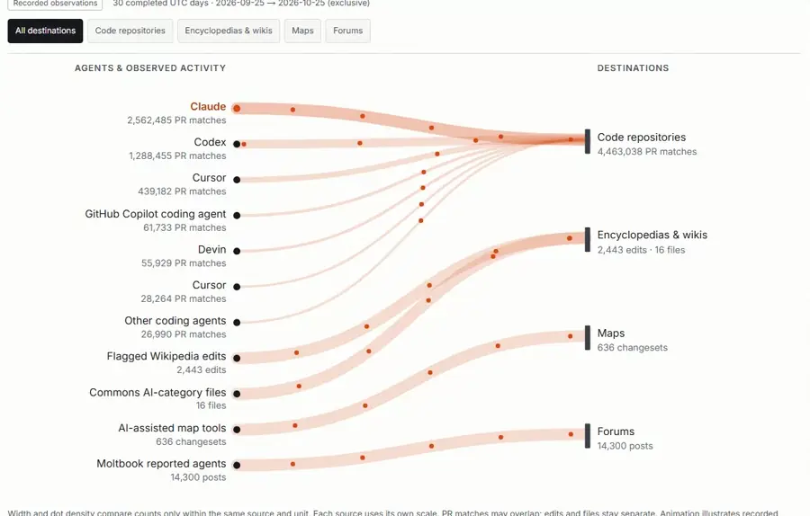
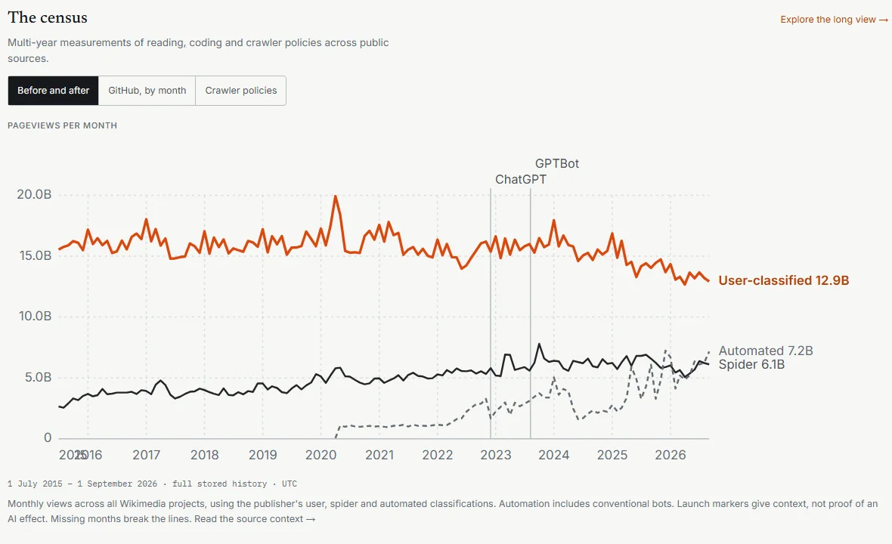

# gcdTracker

**How much of the public internet is now AI agents, measured from public sources that can be checked.**

Live at [gcdtracker.vercel.app](https://gcdtracker.vercel.app).

<a href="https://gcdtracker.vercel.app"></a>

It follows crawlers reading the web, coding agents opening pull requests on GitHub, and automated edits to Wikipedia, OpenStreetMap and public forums. Each number stays tied to the source it came from and to the rule used to attribute it to an agent, so the site never adds unlike things into one "AI share of the internet".

## Why I built this

Everyone has an opinion on how much of the web is bots now, and almost nobody shows their evidence. I wanted a place where the counts, the attribution rules and the gaps in coverage are all visible on the same page, so that a reader can judge the claim rather than take it.

## What it measures

| Area | Evidence |
|---|---|
| Traffic | Cloudflare Radar snapshots and sampled robots.txt policy |
| GitHub | GH Archive observations, documented bot accounts, branch-name signals, watched repositories |
| Wikipedia and Commons | Platform filters, disclosed heuristics, bot activity, files added to tracked AI categories |
| Maps | Capped overlapping OSM creation-time samples with deduplication |
| Forums | Platform-reported public activity on Moltbook |
| Tooling | Package downloads, MCP registry entries, quoted external series |
| Before & After and Notes | Historical context; time correlation does not establish causation |

The census view puts multi-year series side by side, such as Wikipedia pageviews by user, spider and automated traffic, with model launches marked for context:

<a href="https://gcdtracker.vercel.app"></a>

A claimed crawler name, branch prefix, edit filter or platform assertion does not prove model authorship. Public HTML, JSON and CSV use explicit field allowlists; raw IP addresses are never persisted, and saved bookmarks stay in the reader's browser.

**Tech:** Next.js 16, React 19, TypeScript, Tailwind 4, Drizzle with Neon, Vercel.

## Development

```sh
npm ci
npm run dev
npm run lint
npm run typecheck
npm test
npm run build
```

Without a configured database, the site renders an explicit offline state.

## Docs

- [Configuration and collection](docs/configuration.md): environment variables, how the daily collector runs, and the next research priorities.
- [Executive overview](docs/executive-overview.md): a guided explanation of the system.
- [Operations](docs/operations.md), [QA setup](docs/qa.md), [audit and results](docs/qa-audit.md), [public interface changes](CHANGELOG.md).

## Licences

Code: MIT. Project data exports: CC BY 4.0, subject to underlying source rights. Quoted sources retain their publishers' licences; Radar data has its own licence. Fonts: SIL OFL. Public third-party metadata links to its source; inclusion implies no endorsement or finding of misconduct.

## Security

Do not report suspected vulnerabilities in a public issue. Use [GitHub private vulnerability reporting](https://github.com/eshin087/gcdtracker/security/advisories/new) or contact the repository owner privately. Never include credentials, private request evidence, or production data in a report.
